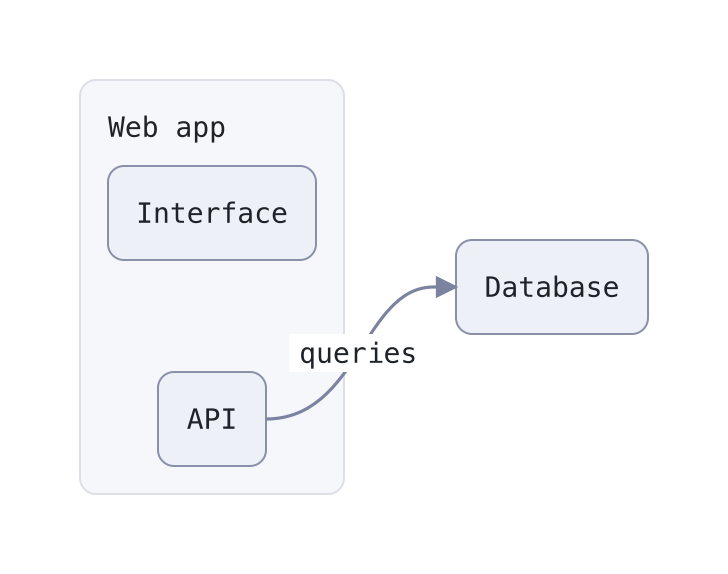

# reladraw-view

A Claude Code mod that draws ` ```reladraw ` code blocks in Claude's replies as images, right in the terminal.

[reladraw](https://github.com/reladraw/reladraw) is a text language for diagrams where you say where things go (`below`, `right of`, `level with`) instead of leaving the layout to an engine. It sits between Mermaid, which places everything for you, and draw.io, where you place everything by hand. reladraw is made by **Joe Walsh** ([@jpwalsh234](https://github.com/jpwalsh234)); many thanks to him for it. This mod only calls the reladraw command-line tool. It contains none of its code and is not affiliated with the reladraw project.

Claude Code already ships a built-in mod that does this for Mermaid: `cc-plugin-mermaid` turns ` ```mermaid ` blocks into box-drawing characters. reladraw-view is the same idea for reladraw, with one difference: reladraw only renders SVG, so the diagram is shown as a real picture via the kitty graphics protocol rather than as text.



The source of that diagram, as Claude would write it in a reply:

````
```reladraw
node app "Web app"
node app.ui  "Interface"
node app.api "API"  below app.ui

node store "Database"  right of app  level with app

edge app.api -> store  "queries"  from: right  to: left
```
````

## Requirements

- A terminal with the kitty graphics protocol: [Ghostty](https://ghostty.org) or [kitty](https://sw.kovidgoyal.net/kitty/). Elsewhere the mod shows a one-line placeholder instead of the picture.
- The reladraw CLI: `npm install -g reladraw`
- `rsvg-convert` from librsvg: `brew install librsvg` (macOS) or your distribution's `librsvg2-bin`
- Both are looked up on `PATH`, with `/opt/homebrew/bin` and `/usr/local/bin` added.

Tested on macOS with Ghostty and Claude Code 2.1.299.

## Install

In a Claude Code session:

```
/plugin install reladraw-view --marketplace perelin/reladraw-view
```

Answer `y` to add the marketplace, then pick a scope (user scope for every project). New sessions load the mod; `/plugin` turns it off or on.

To update: `/plugin marketplace update reladraw-view`, `/plugin update reladraw-view@reladraw-view`, then `/reload-plugins` in a running session.

### Teach Claude the syntax

The mod only draws what Claude writes. To have Claude know reladraw and reach for it, install reladraw's own skill:

```
npx skills add reladraw/reladraw -g -a claude-code
```

Without it, ask for it explicitly ("draw this as a ```reladraw block").

### Background sessions (agent view)

Claude Code turns terminal images off in background sessions, which includes every session started from the agent view (`claude agents`). There the mod shows only the placeholder line. To turn them on, add this to the `env` block of `~/.claude/settings.json`:

```json
{
  "env": {
    "CLAUDE_CODE_FORCE_TERMINAL_IMAGES": "1"
  }
}
```

It applies to sessions whose process starts after the change. The agent view keeps a few session processes started ahead of time and hands one to each new session, so the first sessions after the change may still come from before it. If a new session still shows the placeholder, start one more.

This switch is undocumented, and Claude Code may have reasons to keep images off in background sessions. It worked in Ghostty on 2.1.299.

## Use

Nothing to call: a reply holding a ` ```reladraw ` block shows the picture once Claude has finished writing the block.

- While the block is still streaming, and until the picture is rendered (about a second), it shows as a normal code block.
- The text around the diagram is still Claude Code's own drawing: bullet, indent, markdown, and whatever other mods such as [boxed-ui](https://github.com/perelin/boxed-ui) add. Only the picture is drawn by this mod.
- A diagram reladraw rejects stays a code block, with reladraw's message under it, for example `reladraw: line 2: node "b": "rigth" is not a direction`.
- Blocks over 20,000 characters stay code.

### Theme

Diagrams are rendered with reladraw's `light` theme. A diagram that names its own (`diagram theme: nord`) keeps it. reladraw's themes are `light`, `dark`, `print`, `catppuccin-latte`, `catppuccin-mocha`, `solarized-light`, `solarized-dark`, `gruvbox-light`, `gruvbox-dark`, `nord`, `dracula`, `vesper`, `high-contrast-light` and `high-contrast-dark`. To change the default, edit `DEFAULT_THEME` in `hooks/register.tsx`.

### Cache

Rendered diagrams are kept in `~/Library/Caches/reladraw-view/` (a PNG and an SVG per diagram and theme) and reused across sessions. Delete the folder to clear it.

## How it works

1. A `ui.render` hook on Claude's reply blocks finds closed ` ```reladraw ` fences.
2. Diagrams not rendered yet are queued, and the reply is drawn as usual for now.
3. A timer started at `session.start` runs `reladraw` and `rsvg-convert` (`hooks/script.ts`) for each queued diagram and asks for a redraw. This cannot happen inside the render hook: Claude Code aborts a render hook's calls whenever the reply is drawn again, which happens constantly while it streams.
4. On the redraw, the reply is drawn as Claude Code's own drawing of the text before the diagram, then an `Image` of the PNG, then the text after it.

## Known limits

- **Timestamp mods:** a reply that starts with the code block, under a mod that writes a timestamp in front of every reply (such as message-timestamps), loses the fence: the timestamp lands on the opening line. A sentence before the block avoids it.
- **No light/dark switching:** the theme is fixed and does not follow Claude Code's `/theme`.
- **Terminal only:** desktop, VS Code and mobile show the code block.
- **macOS paths:** the cache folder and the extra `PATH` entries follow macOS conventions; on Linux the cache ends up in `~/Library/Caches` all the same.
- Built on Claude Code's function-hook plugin API, which is in early access and may change between releases.

## Development

Run the mod straight from a checkout; edits reload when a turn ends:

```
claude --plugin-dir path/to/reladraw-view
```

```
claude plugin validate .
claude plugin test .
```

The tests cover splitting a reply into text and diagrams, sizing the picture in terminal cells, and the render hook with `process.run` mocked: code block first, picture once rendered, reladraw's error under the source, nothing for a block still streaming.

## License

[MIT](LICENSE). reladraw itself is licensed under Apache-2.0 by Joe Walsh; see its [NOTICE](https://github.com/reladraw/reladraw/blob/main/NOTICE).
